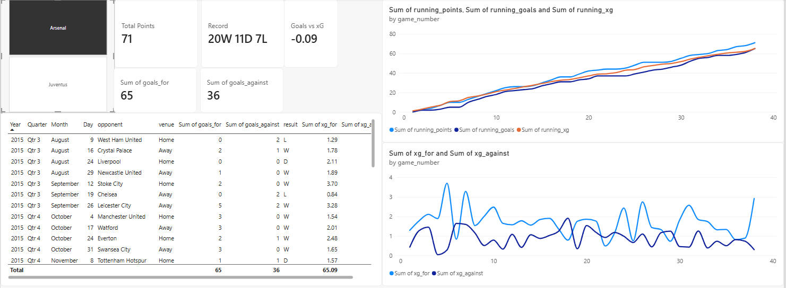
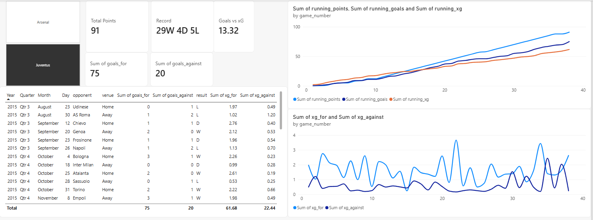
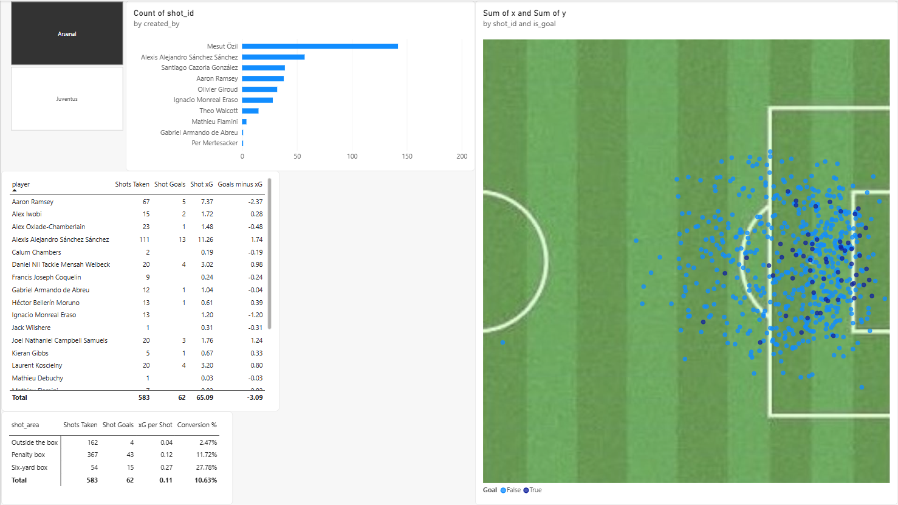
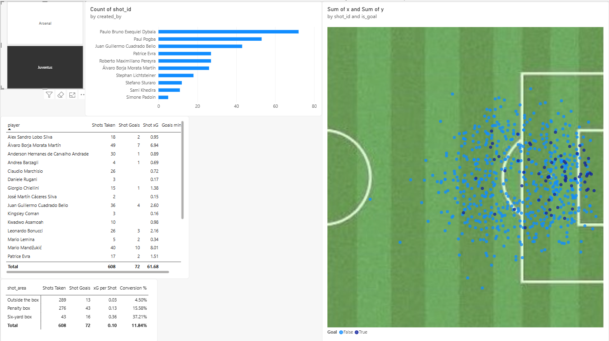
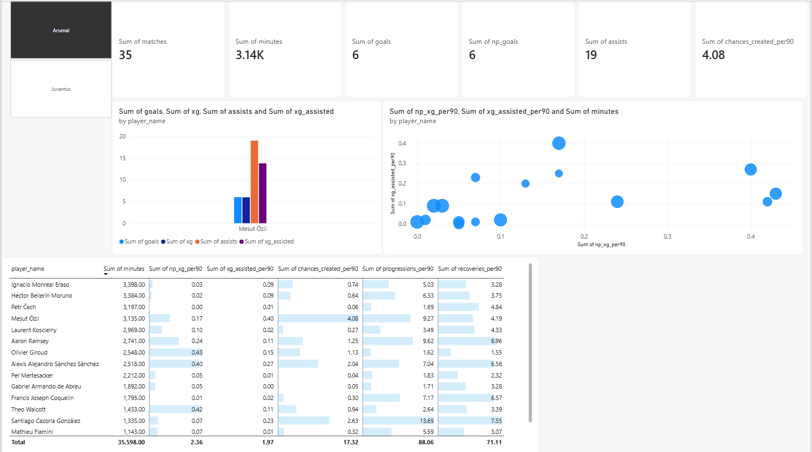
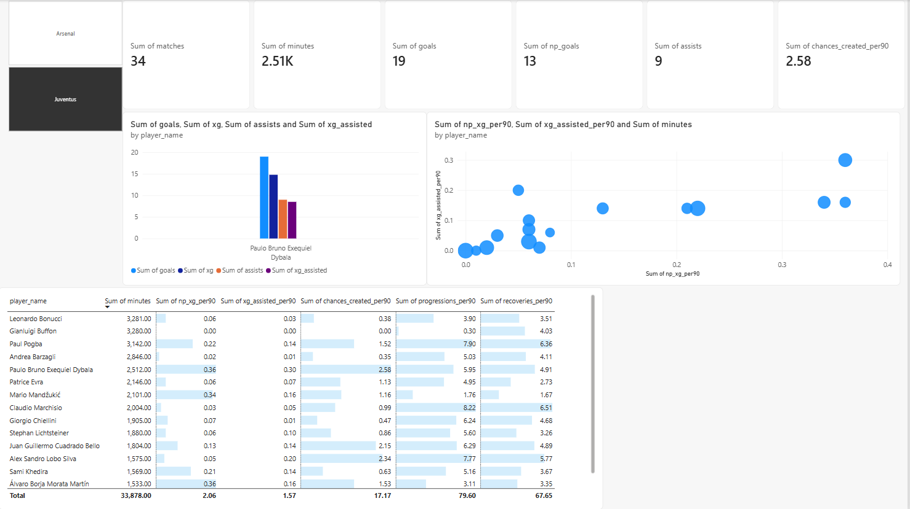
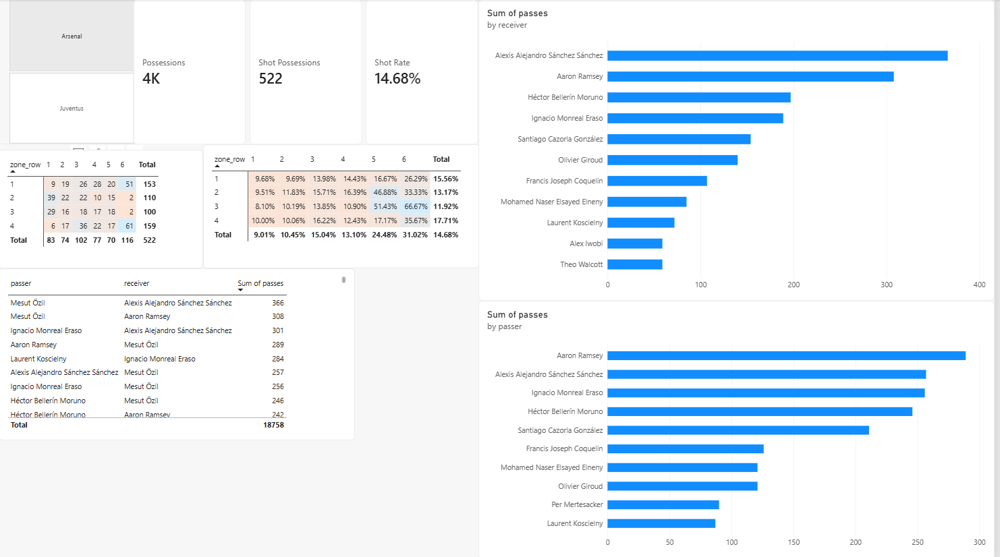
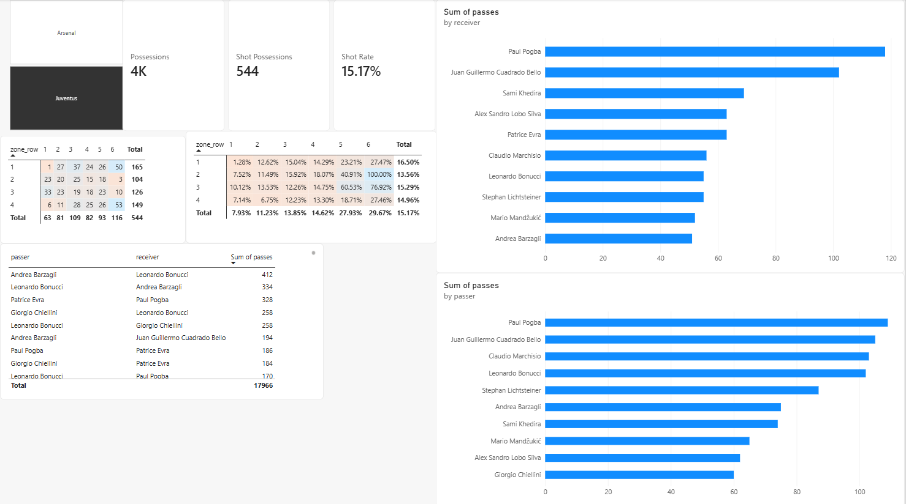

# Childhood Favorites Soccer Tactical Analytics: Arsenal and Juventus, 2015/16

How Arsenal and Juventus built attacks and created chances in 2015/16, and how Mesut Özil and Paulo Dybala impacted that. Built with Python, PostgreSQL and Power BI on StatsBomb's free event data.

**Tools:** Python (pandas, statsbombpy, SQLAlchemy), PostgreSQL, SQL views and window functions, Power BI (DAX measures, data model)

## Pipeline
1. `scripts/download.py` downloads all 76 Arsenal and Juventus league matches (events and lineups) from StatsBomb's open data.
2. `scripts/load.py` flattens nested JSON (coordinates into x/y columns, player position stints into minutes) and loads 279,742 events into PostgreSQL.
3. `sql/quality_check.sql` validates the load: no duplicate event IDs, no passes without a passer, Özil's 19 assists match the official count, and rebuilt league points match the official tables (Arsenal 71, Juventus 91).
4. `sql/views.sql` creates one view per dashboard page; `dashboard/` holds the Power BI file.

## Season overview
**Arsenal**


**Juventus**


Juventus outscored their chances, 75 goals from 61.7 xG. They underperformed through the first 16 games (25 goals from 26.3 xG); from game 17, a 3–2 win over Carpi on December 20, the gap grew steadily to the end of the season. Arsenal's 65 goals matched their 65.1 xG almost exactly.

## Chances
**Arsenal**


**Juventus**


Dybala created more shots than any Juventus teammate (72), but his standout quality was finishing: 19 goals from 14.8 xG, including 6 goals from 2.0 xG outside the box. Özil created far more shots than anyone at Arsenal (142), and his teammates finished them well: 19 goals from 13.8 xG, led by Giroud with 7 goals from 3.2 xG.

## Player impact
**Arsenal**


**Juventus**


Özil's playmaking stands out in his 4.08 chances created and 0.40 xG assisted per 90, alongside strong finishers in Giroud (0.43 xG per 90), Walcott (0.42) and Sánchez (0.40). Cazorla anchored midfield with 13.69 progressions and 7.55 recoveries per 90. Dybala was joint-top for Juventus in xG per 90 (0.36, with Morata) and led in xG assisted per 90 (0.30), while Pogba, Alex Sandro and Marchisio carried the progression and recovery work that freed him to attack.

## Build-up
**Arsenal**


**Juventus**


Dybala's two main partners were Pogba (109 passes to Dybala, 118 from him) and Cuadrado (105 to, 102 from). Özil's most common link was Alexis Sánchez (366 passes to him, 257 back), with Ramsey his biggest supplier (289) and both full-backs feeding him around 250 times each. Both teams' shot-ending attacks most often started on the wings in the final third, and they turned a similar share of possessions into shots (Arsenal 14.7%, Juventus 15.2%).

## How to run it
```
python -m venv .venv
.venv\Scripts\Activate.ps1
pip install -r requirements.txt
python scripts/download.py
python scripts/load.py
```
Then run `sql/views.sql` in pgAdmin and open the `.pbix` file in Power BI Desktop.

## Data
Data provided by [StatsBomb](https://github.com/statsbomb/open-data) (Hudl StatsBomb open data). The raw data is not stored in this repo; the download script rebuilds it.

## Next steps
A pressing page (PPDA and ball-win zones; the views already exist), and pass networks in Python.